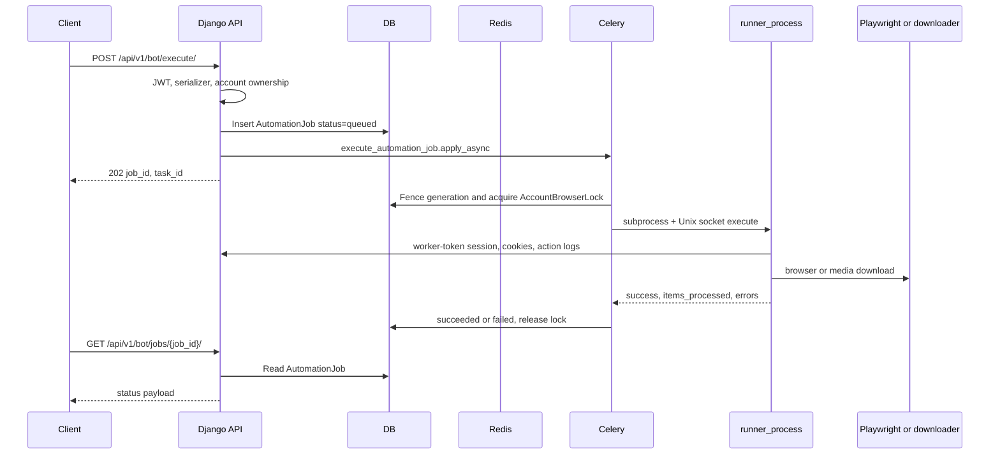
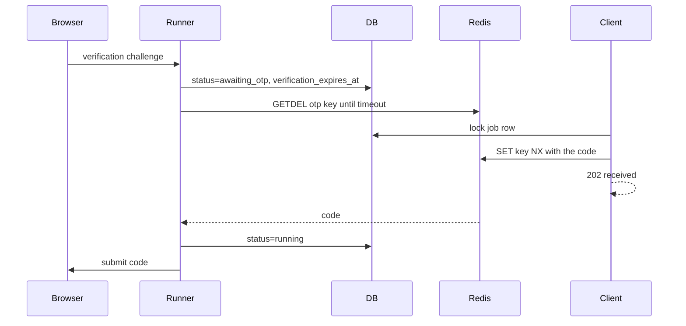

# API execution flows

The sequence below is the live automation path. Dashboard, analytics, and download-table routes stop at the database. They are listed after the automation flows.

## POST `/api/v1/bot/execute/` and `/bot/execute/async/`

Both URLs use `BotExecuteView.post` (`backend/api/bot_execute.py`). The async URL is a subclass with no extra behavior.

1. CORS, session, CSRF, and authentication middleware run. DRF then authenticates JWT or Basic and requires an authenticated user. The worker token is not allowed on this path.
2. `AutomationJobCreateSerializer` validates `account_id`, `action`, `targets`, and `options`.
3. The view loads `BotAccount` owned by the user, or any account if the user is staff. Missing accounts raise `404`. A status other than `active` raises `400`.
4. `submit_automation_job` (`backend/api/job_service.py`) inserts `AutomationJob` with status `queued`. A unique constraint allows one active job per account. An optional `Idempotency-Key` returns the previous job when the payload matches, or `409` when it does not.
5. `execute_automation_job.apply_async(args=[job_id])` publishes to Redis. The Celery id is stored on the row. If publish fails, the row is marked `failed` and the client receives `503`.
6. The HTTP response ends. The request process does not import Playwright.

### Inside the Celery worker

`execute_automation_job` (`backend/api/tasks.py`):

1. Loads the job under `select_for_update` and records the current Celery task id.
2. `resolve_execution_recovery` decides whether this delivery is the initial run, a duplicate, an OTP reconnect, an application retry, or a worker-loss redelivery. Duplicate deliveries and failed OTP reconnects return without starting another browser. Worker-loss recovery is capped.
3. `acquire_account_lock` inserts or takes over `AccountBrowserLock` for the account and generation. A busy or unowned lock fails the job.
4. The action string is mapped to a `TaskType`. `download` selects `AdapterType.DOWNLOADER`. Every other supported action selects `AdapterType.PLAYWRIGHT`. An unknown action raises, and the job is failed.
5. `BrowserRunnerSupervisor.start` runs `python -m orchestrator.runner_process` in its own session, with the runner id, job id, generation, profile path, and socket path in the environment. The profile directory is `$INSTABOT_PROFILE_ROOT/<account_id>` (Compose uses `/app/profiles`).
6. The supervisor waits for the socket, checks pid start ticks and container boot id, then authenticates with `INSTABOT_RUNNER_IPC_SECRET` (required by `require_runner_secret`).
7. Runner identity is written by `register_browser_runner`. A heartbeat task renews the account lock every 300 seconds. If renewal fails, the supervisor sends `disable_actions` and the job fails.
8. `supervisor.execute()` sends command `execute`. The runner builds `UnifiedWorker` and calls `start_session`, `execute`, `cleanup`, and `stop_session`.
9. On a normal return, the task writes `succeeded` or `failed`, `result`, and `error` if the generation still matches and the job was not cancelled. It then releases the account lock.

`scrape_profile` failures while status is still `running` retry up to twice, with countdown `min(30, 2 ** (retries + 1))`, after releasing the lock and setting status `retrying`. Other exceptions mark the job `failed` and re-raise.

Startup of the Celery consumer runs `reconcile_startup_jobs` before the consume loop (`backend/config/celery.py` and `backend/api/reconciliation.py`). That path can requeue a lost task or terminate an orphaned runner process group. It is not an HTTP API.

### Inside the runner for Playwright

`orchestrator/runner_process.py` `_execute_payload`:

1. `UnifiedWorker.start_session` calls `POST /api/v1/bots/control/` with `action=start` using the worker token. That creates a `Session` row.
2. For Playwright, the runner calls `django.setup()` and passes `verification_callback` in options. The callback is `_wait_for_job_otp` from `backend/api/tasks.py`.
3. `PlaywrightAdapter.initialize` loads the account through `InstaApiClient.get_account` and starts `InstagramBrowser`.
4. Before an authenticated action, the adapter loads cookies through `CookieSync`. Cookie login is attempted first. If that fails, it decrypts `BotAccount.password_encrypted` with Django ORM inside the runner and calls `browser.login`. A verification callback marks the job `awaiting_otp` and polls Redis.
5. The adapter dispatches to like, follow, unfollow, scrape, stories, or comment handlers in `orchestrator/adapters/playwright_adapter.py`, which call methods on `InstagramBrowser`.
6. `ActionCallback` posts each result to `POST /api/v1/analytics/actions/`.
7. `stop_session` calls `POST /api/v1/sessions/{id}/end/`.

If `INSTABOT_FAKE_BROWSER=1`, the runner returns a synthetic success and does not open Playwright. That switch is for the failure harness, not for production traffic.

### Download action

The same runner path is used, with `DownloaderAdapter` instead of Playwright. The adapter constructs `automation.downloader.media_downloader.MediaDownloader` and downloads the target URLs. It does not create `downloads.Download` rows and does not call `upload_media_to_s3`.

## OTP submission

The Redis key comes from `otp_redis_key(job_id, execution_generation)` in `backend/api/verification.py`. The client and the runner must use the same broker URL. A second `SET NX` while a code is unread returns `409`. When the job is cancelled or the generation changes, the waiter stops and the code is deleted.

`GET` job status also expires an `awaiting_otp` job whose `verification_expires_at` is in the past, by marking it `failed`.

## Cancellation

`POST /api/v1/bot/jobs/{id}/cancel/`:

- `queued` or `retrying`: status `cancelled`, `cancel_requested=True`, and `celery.control.revoke(task_id, terminate=False)`.
- `running` or `awaiting_otp`: status `cancelling` and `cancel_requested=True`. The OTP deadline is cleared. The runner's OTP loop and the worker's post-execution write observe the flag. There is no signal sent to the browser process by this view.
- The supervisor closes the runner process group after `execute` returns, including cancellation during the normal `finally` path. A cancel that arrives mid-browser-action does not by itself kill the subprocess until the task finishes or the lock heartbeat fails.

## Health

`GET /api/v1/health/` checks Django's database connection and `PING`s Redis. Either failure yields `503` with `status=not_ready`. It does not inspect Celery workers.

`GET /api/v1/health/detailed/` calls `get_overall_health()` (`backend/api/health.py`): database, Redis broker queue depths, Celery `inspect` with a 2 second timeout, and live runner identity for non-terminal jobs. It returns `200`, `207`, or `503`. The view does not enqueue recovery. Recovery remains the worker startup step and `manage.py reconcile_automation_jobs`.

## Routes that never leave the database

`settings`, bot status, bot control, bulk control, rate limits, system status, cleanup, exports, account CRUD, session CRUD, analytics CRUD, dashboard, account stats, and the download viewsets follow the same short path:

`middleware → JWT or worker token → permission → view or viewset → serializer → ORM → JSON`.

Bot control is the important special case. `start` inserts `Session(status=active)`. The orchestrator later calls that same endpoint, so a "running bot" on the dashboard means an open session row, not a live Playwright process. Live browser identity is on `AutomationJob.runner_*` and `AccountBrowserLock`.

`UpcomingScheduleView` returns an empty list and has no model.

`DownloadQueueViewSet.process` inserts a pending `Download` and stops. No Celery signature and no downloader import exist in `backend/downloads/views.py`.

## WebSocket

A session-authenticated client can connect to `ws/updates/`. The consumer accepts the socket and waits for channel events named `bot_update`. Job execution never emits those events, so the socket stays quiet. Job progress is retrieved by polling `GET /api/v1/bot/jobs/{job_id}/`.
