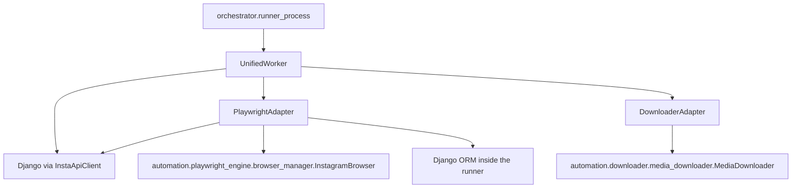

# Automation architecture

Automation code is split across `automation/` (engines) and `orchestrator/adapters/` (the only selection layer the runner uses). Presence of an engine does not mean a job can reach it.

## Live path

`PlaywrightAdapter` is constructed only after the runner receives `adapter_type=playwright`. Its handlers call `InstagramBrowser` for login, profile scrape, posts, likes, unlikes, follow, unfollow, stories, and comments. Unlike is implemented on the adapter and is not one of the seven job actions, so the API cannot request it.

`DownloaderAdapter` is constructed for `adapter_type=downloader`. It wraps `MediaDownloader` and supports image, video, carousel, story, and bulk download task types. The job map only sends `BULK_DOWNLOAD`.

## Session, cookies, and credentials

| Data | Where it lives | Who reads it on the live path |
| --- | --- | --- |
| Instagram username and encrypted password | `account.BotAccount` | Playwright adapter, Django ORM, `account.utils` |
| Cookies | `cookies_encrypted` / cookie metadata on `BotAccount` | `CookieSync` through `POST /api/v1/accounts/{id}/update_cookies/` and the matching read on `GET /api/v1/accounts/{id}/` |
| Browser profile | Directory `$INSTABOT_PROFILE_ROOT/<account_id>` | Runner environment `INSTABOT_RUNNER_PROFILE_PATH` |
| Dashboard session row | `account.Session` | `start_session` and `stop_session` via bot control and `sessions/{id}/end/` |
| Action audit | `analytics.ActionLog` | `ActionCallback._log_action` |
| OTP | Redis key from `api.verification.otp_redis_key` | Runner waiter and verification API |

`automation/playwright_engine/multi_account_manager.py` can hold more than one browser. The runner creates one `UnifiedWorker` for the job's `account_id` and does not call the multi-account manager.

## Engines that are not selected

| Tree | Adapter | Reached by `execute_automation_job` |
| --- | --- | --- |
| `automation/playwright_engine/` | `PlaywrightAdapter` | Yes |
| `automation/downloader/` | `DownloaderAdapter` | Yes, action `download` only |
| `automation/selenium_engine/` | `SeleniumAdapter` | No. Adapter class exists and would import this tree if constructed |
| `automation/selenium/` | None on the runner path | No. Parallel Selenium tree, not the adapter's import |
| `automation/scrapy_project/` | `ScrapyAdapter` | No |
| `automation/safety/` | `SafetyAdapter` | No. Playwright handlers do not import `RateLimiter` |

`SafetyAdapter.initialize` builds the in-process safety objects from `automation.safety`, including a rate limiter. Because no caller passes `AdapterType.SAFETY`, those objects are not consulted before likes or follows. `RedisRateLimiter` is therefore unused by the live job. The rate-limit HTTP endpoint does not call it either.

The empty `backend/services/` packages were removed. Job execution does not go through a service package.

## Tests and manual entry points

| Location | What it exercises |
| --- | --- |
| `backend/api/test_automation_jobs.py`, `test_automation_task_results.py`, `test_account_locks.py`, `test_browser_runner.py`, `test_startup_reconciliation.py` | Job API, locks, runner IPC, reconciliation |
| `backend/account/test_session_management.py` | Cookie and session updates |
| `automation/playwright_engine/tests/` | Profile, cookies, and 2FA helpers |
| `automation/safety/tests/test_rate_limiter.py` | Safety limiter in isolation |
| `test/playwright/` | Script-style action tests, not the Celery path |
| `orchestrator/bot_worker.py` | Manual Playwright worker |
| `backend/api/d16_failure_harness.py` | Failure drills. Sets `INSTABOT_FAKE_BROWSER` so the runner skips Instagram |

## Error behavior on the live path

Adapter failures return `TaskResult.success=False` and an `errors` list. The Celery task stores that as job status `failed` unless the job was cancelled or the generation changed. Playwright login errors include cookie persistence failures and password decrypt failures. A missing runner secret or a runner that exits before the socket appears raises `RunnerSupervisorError`, which fails the Celery task and the job.

The fake-browser switch returns success without contacting Instagram. It is not enabled by Django settings. It is enabled only when the runner environment contains `INSTABOT_FAKE_BROWSER=1`.
