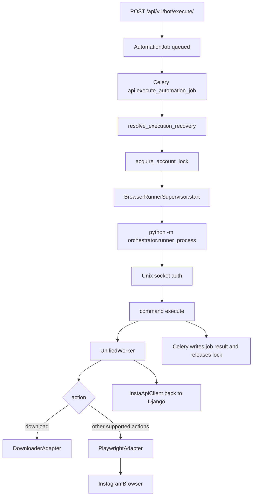

# Orchestrator architecture

The orchestrator is the worker-side bridge between a Celery task and an automation adapter. It does not listen for HTTP requests. Django never imports it during `POST /api/v1/bot/execute/`. The Celery task starts it indirectly, by launching a child process.

## Responsibilities

| Module | Responsibility |
| --- | --- |
| `orchestrator/runner_supervisor.py` | Start, authenticate, command, and stop the runner process group |
| `orchestrator/runner_process.py` | Unix-socket server. Builds `UnifiedWorker` and runs one `execute` command |
| `orchestrator/runner_ipc.py` | HMAC challenge, pid start-ticks, container boot id |
| `orchestrator/unified_worker.py` | Session lifecycle and adapter selection |
| `orchestrator/api_client.py` | HTTP calls back into Django with `X-Worker-Token` |
| `orchestrator/callbacks.py` | Turns adapter results into `POST /api/v1/analytics/actions/` |
| `orchestrator/cookie_sync.py` | Read and write account cookies through the API client |
| `orchestrator/adapters/playwright_adapter.py` | Login and browser actions |
| `orchestrator/adapters/downloader_adapter.py` | Media download for action `download` |
| `orchestrator/bot_worker.py` | Older Playwright-only worker with a `__main__` entry. The Celery path does not use it |
| `orchestrator/adapters/selenium_adapter.py`, `scrapy_adapter.py`, `safety_adapter.py` | Implemented adapters with no production selector |

## How a job arrives

There is no orchestrator queue of its own. Job identity is the `AutomationJob` UUID plus `execution_generation`. The Celery task id is stored on the job and is replaced when a later delivery runs. The runner id is a new UUID created by the supervisor and stored on the job and the account lock.

## Dispatch and adapter selection

Selection happens in `execute_automation_job`, not inside `UnifiedWorker`:

| `AutomationJob.action` | `TaskType` | Adapter |
| --- | --- | --- |
| `like` | `LIKE_POSTS` | Playwright |
| `follow` | `FOLLOW_USERS` | Playwright |
| `unfollow` | `UNFOLLOW_USERS` | Playwright |
| `scrape_profile` | `SCRAPE_PROFILE` | Playwright |
| `view_stories` | `VIEW_STORIES` | Playwright |
| `comment` | `COMMENT` | Playwright |
| `download` | `BULK_DOWNLOAD` | Downloader |

`UnifiedWorker.get_adapter` can also construct Selenium, Scrapy, and Safety adapters. The Celery task never passes those adapter names. `bot_worker.py` can construct a Playwright worker directly, but no URL or Celery task calls it. Those adapters stay in the tree as deprecated optional backends. See `docs/audit/REPOSITORY_CLEANUP_REPORT.md`.

IPC authentication uses `INSTABOT_RUNNER_IPC_SECRET`. The runner refuses a second authenticated IPC client. Commands are `identity`, `disable_actions`, and `execute`. `execute` is ignored when `browser_actions_enabled` is false.

## Browser and session state

1. The supervisor sets `INSTABOT_RUNNER_PROFILE_PATH` to the account directory under `INSTABOT_PROFILE_ROOT`.
2. The Playwright adapter starts `InstagramBrowser` from `automation/playwright_engine/browser_manager.py` with that persistent profile.
3. `UnifiedWorker.start_session` posts `action=start` to `/api/v1/bots/control/`, which creates `account.Session`. The returned `session_id` is kept only in the worker object and is passed to `ActionCallback`.
4. Cookies are loaded and saved through `CookieSync` → `InstaApiClient.update_cookies` → `POST /api/v1/accounts/{id}/update_cookies/`.
5. The password is not sent by the client. The adapter reads `password_encrypted` with the Django ORM after `django.setup()` in the runner and decrypts it with `account.utils.decrypt_password`.
6. Login challenges call the runner's `verification_callback`, which flips the job to `awaiting_otp` and waits on Redis. See `docs/api/API_EXECUTION_FLOWS.md`.

Credentials and session cookies are not accepted in job `options`. The serializer rejects those keys.

## Execution state, retries, and results

Durable state is `AutomationJob.status`:

`queued` → `running` → (`awaiting_otp` → `running`) → `succeeded` or `failed`

Cancel adds `cancelling` and `cancelled`. Application retry uses `retrying`.

`execution_generation` is a fence. Result writes and OTP updates include the generation in the `UPDATE` filter, so a stale runner cannot finish a newer attempt. `ExecutionRecoveryRecord` stores one recovery decision per failed generation so a redelivered Celery message cannot apply the same recovery twice.

Retries that exist in code:

- `scrape_profile` only, up to 2 Celery retries, while the job is still `running`
- worker-loss redelivery through `resolve_execution_recovery` and startup reconciliation, with an explicit loss limit
- OTP reconnect when the runner process is still alive and its IPC path is still registered

The runner returns `{success, items_processed, errors, data}`. The Celery task stores a summary on `AutomationJob.result` and joins errors into `AutomationJob.error`. The client sees that only by polling the job URL. The orchestrator does not call the job-status API and does not publish a WebSocket event.

## Monitoring and cancellation

Monitoring that is implemented:

- `GET /api/v1/health/detailed/` reads runner pid, start ticks, and heartbeat fields. It does not act on them.
- The Celery task renews `AccountBrowserLock` every 300 seconds during `execute`.
- `api.healthcheck` calls `reconcile_expired_locks`. Nothing in settings schedules that task.
- Worker startup and `manage.py reconcile_automation_jobs` call `reconcile_startup_jobs`, which can requeue a missing Celery message or signal an orphaned process group.

Cancellation that is implemented:

- The cancel API sets `cancel_requested` and, for queued work, revokes the Celery message without killing a worker process.
- The OTP waiter exits when `cancel_requested` is set.
- After `execute` returns, the supervisor sends `disable_actions`, then `SIGTERM` and, if needed, `SIGKILL` to the runner process group.
- A cancel request does not itself send `SIGTERM`. A browser action already inside Playwright runs until it returns, unless the lock heartbeat fails and `disable_actions` is sent.

## Concurrency

- Database constraint: one active `AutomationJob` per `BotAccount`.
- `AccountBrowserLock` is one row per account. Acquire, renew, and release check owner token and generation (`backend/api/account_locks.py`).
- Celery Compose command uses `--pool=solo`, so one worker process runs one task at a time. Other accounts still queue behind that process.
- Each job gets its own runner process and socket. The runner accepts one IPC client.
- Startup reconciliation takes a Postgres advisory lock when the database vendor is PostgreSQL, so two workers do not reconcile the same jobs concurrently. SQLite has no equivalent lock in that function.

## What the orchestrator does not do

- It does not import Celery and does not enqueue tasks.
- It does not import Spark.
- It does not read `downloads.Download` or `DownloadQueue`.
- It does not call `automation/safety` on the Playwright path. Safety is a separate adapter that the job map never selects.
