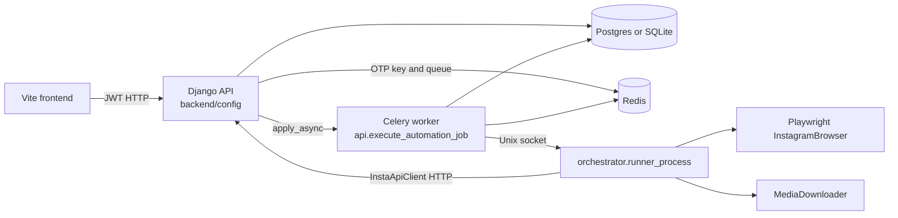
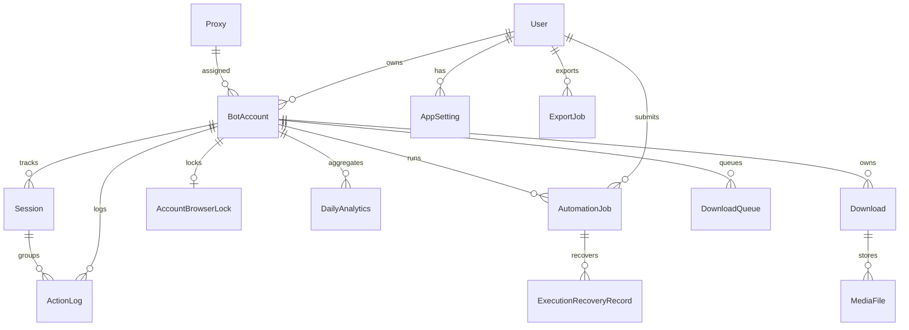

# Project overview

Insta-Bot is a Django REST dashboard plus a Celery worker that runs Instagram account actions in a separate browser-runner process. The request that starts work does not drive the browser. It writes an `AutomationJob` row and enqueues `api.execute_automation_job`. The worker acquires a per-account database lock, starts `python -m orchestrator.runner_process`, and talks to that process over a Unix socket. The runner uses `UnifiedWorker` and, for every action except `download`, the Playwright adapter.

This document describes the code that is actually mounted and called. Older write-ups in `docs/legacy/` describe a wider platform (Spark analytics, Scrapy crawls, Selenium fallback, live WebSocket fan-out, S3 upload tasks) that is only partly present.

## Purpose

The running product lets an authenticated user:

- register and obtain JWT access tokens
- store Instagram bot accounts, proxies, and session rows
- queue one active automation job per account (`like`, `follow`, `unfollow`, `scrape_profile`, `view_stories`, `download`, `comment`)
- submit a one-time verification code while a job waits
- cancel a queued or running job
- read analytics rows, export files, and download-queue records

Browser start/stop buttons on the dashboard change `Session` and `BotAccount` rows. They do not launch Playwright.

## Technology stack

| Layer | Implementation |
| --- | --- |
| API | Django 4.2, Django REST Framework, `drf-spectacular`, SimpleJWT |
| ASGI | Daphne is installed; `config.asgi` mounts HTTP and one WebSocket route |
| Database | PostgreSQL when `DB_HOST`, `DB_NAME`, `DB_USER`, and `DB_PASSWORD` are set; otherwise SQLite at `backend/db.sqlite3` |
| Queue | Celery, Redis broker (`CELERY_BROKER_URL`, default db 0) and result backend (default db 1) |
| Browser automation | Playwright through `automation/playwright_engine/browser_manager.py` |
| Runner isolation | `orchestrator/runner_supervisor.py` subprocess plus authenticated Unix-socket IPC |
| Frontend | Vite app in `frontend/` (dev server port 5173 in Compose) |
| Optional, not on the request path | Spark (`spark_jobs/`, Compose profile `analytics`), MongoDB and a Node service (profile `optional-data`) |

## Major components

## Directory responsibilities

| Path | Responsibility in the current code |
| --- | --- |
| `backend/config/` | Settings, root URLs, Celery app, ASGI/WSGI |
| `backend/api/` | Auth-adjacent dashboard routes, automation jobs, locks, reconciliation, health |
| `backend/account/` | `Proxy`, `BotAccount`, `Session` and their viewsets |
| `backend/analytics/` | `DailyAnalytics`, `ActionLog`, `UserBehavior` |
| `backend/downloads/` | Download, queue, and media-file records. Creating a row does not download media |
| `backend/core/` | Worker-token authentication and the DRF exception handler |
| `backend/seed_data.py` | Manual sample-data script. Not used by Compose or the API |
| `orchestrator/` | Worker-side API client, adapters, browser-runner supervisor and IPC |
| `automation/playwright_engine/` | Browser, login, cookies, and the actions the Playwright adapter calls |
| `automation/downloader/` | HTTP media downloader used when the job action is `download` |
| `automation/selenium/`, `automation/selenium_engine/` | Selenium implementations. No job action selects them |
| `automation/scrapy_project/` | Scrapy project. No job action selects it |
| `automation/safety/` | Rate-limit, delay, and health helpers. The live Playwright path does not call them |
| `spark_jobs/` | Standalone PySpark scripts. Nothing in Django or the orchestrator imports them |
| `frontend/` | Dashboard UI |
| `infradocker/` | Dockerfiles and Compose env example |
| `test/playwright/` | Script-style Playwright tests outside the Django suite |
| `docs/legacy/` | Previous documentation. Not authoritative |

## Application entry points

| Entry | Role |
| --- | --- |
| `backend/manage.py` | Django management. Compose runs `runserver` on port 8000 |
| `backend/config/wsgi.py` and `backend/config/asgi.py` | HTTP entry. ASGI also mounts `ws/updates/` |
| `backend/config/celery.py` | Celery application `config`. On consumer start it runs startup reconciliation |
| `python -m orchestrator.runner_process` | Browser runner. Started by the Celery task, not by a user command in normal operation |
| `orchestrator/bot_worker.py` `main()` | Manual Playwright-only worker. Imported by the package and by cookie tests. Not called by the API |
| `spark_jobs/spark_app.py` | Manual Spark session script. The analysis call is commented out |
| `backend/api/management/commands/reconcile_automation_jobs.py` | Operator command for the same reconciliation used at worker startup |
| Django admin `/admin/` | Staff UI for installed models |

`ROOT_URLCONF` is `config.urls`. Every HTTP route below is mounted from `backend/config/urls.py`.

## Runtime processes

Default Compose services in `docker-compose.yml` (no profile):

1. `db` — Postgres 15
2. `redis` — Redis 7
3. `backend` — Django `runserver`, with debugpy on port 5678
4. `worker` — `celery -A config worker --pool=solo`. The Compose command also starts debugpy with `--wait-for-client`, so that container does not consume the queue until a debugger attaches
5. `frontend` — Vite dev server

Profile `analytics` adds `spark-master`. Profile `optional-data` adds `mongodb` and `node-ws`. Neither profile is required for account automation.

There is no Celery Beat schedule in settings. `api.healthcheck` exists and reconciles expired account locks, but nothing in the repository schedules it.

## External dependencies

- Instagram, reached only from the Playwright browser or the media downloader inside the runner
- Redis, for the Celery broker, Celery results, and one-time verification codes
- PostgreSQL in Compose and any environment that sets the `DB_*` variables
- Optional AWS S3 settings are read in `settings.py` and `downloads/tasks.py`. No mounted API calls `upload_media_to_s3`
- Optional MongoDB URIs appear only in Spark scripts and the optional Node service

## Authentication and middleware

Middleware order in `backend/config/settings.py`:

1. CORS
2. Security
3. Session
4. Common
5. CSRF
6. Authentication
7. Messages
8. X-Frame-Options

DRF defaults:

- authentication: `WorkerTokenAuthentication`, then JWT, then HTTP Basic
- permission: `IsAuthenticated`
- pagination: page number, size 20
- exception handler: `core.exceptions.api_exception_handler`

`WorkerTokenAuthentication` accepts `X-Worker-Token` only on a fixed list of paths (`backend/core/auth/worker.py`): get account, update cookies, update session status, bot control, end session, create an action log, and the basic health check. Other routes reject the worker token even when the secret matches.

JWT access tokens last one hour. Refresh tokens last seven days and are rotated. `BLACKLIST_AFTER_ROTATION` is true, but `rest_framework_simplejwt.token_blacklist` is not in `INSTALLED_APPS`, so rotation does not persist a blacklist.

Public exceptions to `IsAuthenticated`: `POST /api/v1/register/`, `GET /api/v1/health/`, `GET /api/v1/health/detailed/`, and the SimpleJWT token routes. `ProxyViewSet` requires `IsAdminUser`.

## Data model

`AutomationJob` enforces one non-terminal job per account (`queued`, `running`, `retrying`, `awaiting_otp`, `cancelling`) and one idempotency key per user. Account browser locks are the authoritative lock for a persistent browser profile. Runner identity (pid, start ticks, boot id, process group, socket path) is stored on both the job and the lock.

## Important implementation observations

- `POST /api/v1/bot/execute/` and `POST /api/v1/bot/execute/async/` are the same view hierarchy. Both enqueue Celery and return `202`. Neither waits for Instagram.
- The Celery task starts `BrowserRunnerSupervisor`, which starts the runner process. The runner is what constructs `UnifiedWorker`.
- Job actions map to Playwright except `download`, which maps to `DownloaderAdapter`. Selenium, Scrapy, and Safety adapters are never selected by `execute_automation_job`.
- `POST /api/v1/bots/control/` creates or closes `Session` rows and can pause an account. It does not enqueue `execute_automation_job`.
- `GET /api/v1/schedule/upcoming/` always returns `{ "items": [] }`.
- `GET /api/v1/rate-limits/` returns hardcoded daily/hourly caps plus `ActionLog` counts. It does not read `automation/safety`.
- The WebSocket consumer joins group `bot_updates`. No Python module calls `group_send` for that group. The channel layer is in-memory.
- Download viewsets persist `Download` and `DownloadQueue` rows. `DownloadQueueViewSet.process` creates a pending `Download` and does not fetch media. `downloads.tasks.upload_media_to_s3` has no callers.
- Spark is not invoked by any API, service, Celery task, or orchestrator module. `spark_jobs/spark_app.py` calls `SparkSession.builder.get_create()`, which is not a PySpark method, and the analysis function is commented out in `__main__`.
- Two Selenium trees exist (`automation/selenium` and `automation/selenium_engine`). The Selenium adapter imports the `selenium_engine` tree only when that adapter is constructed.
- Structured JSON logging with redaction is configured for the `api` and `orchestrator` loggers (`backend/api/logging.py`).
